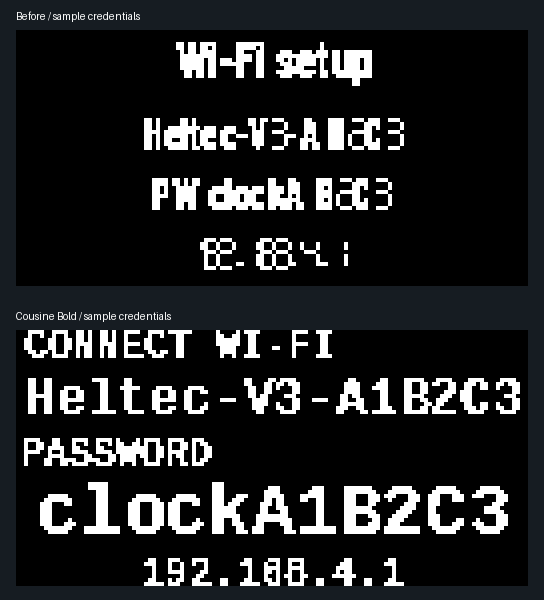
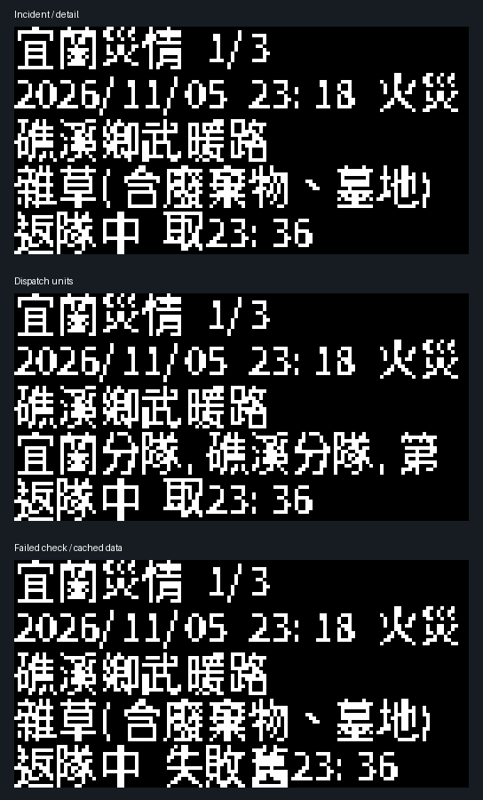

# Heltec V3：時鐘、礁溪天氣與宜蘭災情

以 Heltec-V3-Weather v1.2.4 原始碼為基礎，新增宜蘭消防局災情頁。本分支為 **`宜蘭災情版`／v1.4.1-usb-demo**；原本的 `main` 與既有版本保持不變。此 repo 提供可編輯程式、完整字庫、測試、預覽與驗證摘要，不提交韌體二進位或裝置設定備份。

[目前狀態](STATUS.md) · [實機驗證](docs/VALIDATION.md) · [MIT 授權](LICENSE) · [第三方標示](THIRD_PARTY_NOTICES.md) · [原版 main](https://github.com/MAXXTANG/Heltec-V3-Weather/tree/main)

## 操作

- 一般瀏覽短按 PRG／BOOT：時鐘 → 天氣 → 災情第 1 件 → 第 2 件 → … → 最後一件 → 時鐘。連按兩下會前進兩步；三連按仍啟動倒數。
- 連按三下：30 秒倒數，最後 10 秒以 4 Hz 閃爍，結束播放煙火後返回原頁。
- 長按約 3 秒：Wi-Fi 配網，沿用原本 `v3-clock` 設定空間。
- 災情頁每 4 秒顯示下一段長文字，並交替顯示案別與派遣分隊。案件本身不再自動輪播，按 BOOT 才看下一件；重新進入從最新案件開始。
- 新案通知：第一輪成功查詢只建立基準；之後發現新案會切換到該案，以每秒 2 次的反白／正常交替閃爍 3 秒，再正常顯示並持續停留。只有手動短按 BOOT 才確認通知並返回時鐘；三連按在通知停留狀態也會確認返回時鐘，不啟動倒數。可提前按 BOOT 結束提醒。
- 查詢結果若在倒數期間收到新案，會停止倒數並優先顯示通知。倒數期間尚未啟動的網路查詢仍延後到倒數結束。

## 資料與更新

資料來源：[宜蘭縣消防局即時災情](https://nfa119.e-land.gov.tw/DTS/caselist/html)。V3 透過 2.4 GHz Wi-Fi 直接以 HTTPS 讀取官方 HTML，不需要中繼電腦、API 金鑰或雲端服務。

災情每輪讀取完成後約 60 秒再次查詢；連線、NTP、天氣請求與倒數期間可能使間隔延長，這是輪詢，並非官方推播。天氣仍約每 15 分鐘更新，失敗約 5 分鐘後重試。NTP 約每 15 分鐘校時。

災情欄位包含受理日期時間、案類、案別、地點、派遣分隊及執行狀況。畫面省略地點開頭的「宜蘭縣」，其餘文字按完整字元分段，保留最多 8 件最新紀錄。網站目前的舊案件與已返隊案件會照實顯示，案件日期時間不等於讀取時間；不推定仍在救援。

最下行的「取HH:MM」是最後成功取得資料的本地時間。「失敗舊」代表最近一次讀取失敗，仍顯示上次成功資料；超過 3 分鐘未成功取得則標記「過期舊」。剛開機尚未成功取得時顯示「尚無可用資料」。只有官方表格欄位完整、但確實沒有資料列時才顯示「網站目前無案件」。快取保存在 RAM，重開機後重新讀取。

HTTPS 驗證 TWCA Global Root CA 與主機名稱；不使用 `setInsecure()`。回應上限 64 KiB，檢查 HTTP 傳輸完整性、表格欄名、日期及各欄長度；網站改版或異常回應會保留舊資料並標記失敗。HTML 註解內的示範案件會被排除。

## 中文與字型

2026-11-06 可讀性更新（v1.3.1）：配網與英文提示改用 Cousine Bold 等寬粗體；Wi-Fi 名稱獨立使用 13 px，密碼放大至 18 px，並明確區分標籤與實際密碼。數字 0 加上斜線，避免和字母 O 混淆。日期／地名的英文頁首也使用新字體，七段式時間與倒數維持原樣。字型原檔、產生工具及 SIL OFL 授權皆附在本專案。



內建 Noto Sans CJK TC Regular 的 12 px 單色點陣，包含 ASCII、CJK 基本漢字、擴展 A 與常用標點，共 27,983 個字形；未涵蓋的罕用字顯示 `?`。字型授權見 `third_party/fonts/Noto-CJK-OFL.txt`。字庫已包含在 `src/disaster_font.h`，一般編譯無需下載字型。

重新產生字庫：先取得 Noto 官方的 `Sans/OTF/TraditionalChinese/NotoSansCJKtc-Regular.otf`，再執行 `python3 tools/generate_disaster_font.py /absolute/path/to/font.otf`。

## 編譯與驗證

需求：Python 3.10+，原生測試另需 `clang++` 或以 `CXX` 指定 C++ 編譯器。使用鎖定版本的 PlatformIO 與函式庫：

```sh
git clone --branch '宜蘭災情版' https://github.com/MAXXTANG/Heltec-V3-Weather.git
cd Heltec-V3-Weather
python3 -m venv .venv
source .venv/bin/activate
python -m pip install -r requirements.txt
python tools/build.py
sh tests/run.sh
```

Windows 使用 `.venv\Scripts\activate` 啟用虛擬環境。`tools/build.py` 首次建置需下載工具鏈，之後使用專案的 PlatformIO 快取。板型是 `heltec_wifi_lora_32_V3`，ESP32-S3、8 MB Flash、原 `default_8MB.csv` 分割表；應用程式輸出為 `.pio/build/heltec-v3/firmware.bin`。測試使用 ASan／UBSan 驗證資料解析、OLED 畫面、倒數、電池與頁面紀錄，並產生畫面預覽。



備份與實機結果另記錄於 `docs/VALIDATION.md`。`backups/` 可能包含原裝置的網路設定，僅供本機復原，已列入忽略清單。

已實測的本機 v1.4.1 應用程式為 1,671,712 bytes，SHA-256 與建置資料見 [build-info.json](docs/build-info.json)。其中 `app_file` 是本機保存名稱，並非 repo 下載連結；重新編譯的雜湊可能因環境或建置路徑不同而改變。本機舊版及完整 Flash 備份仍保留，不隨此分支上傳。

本次只備份至 Git，沒有再次刷機。需更新裝置時，先核對板型與完整備份，再檢查分割表及實際啟動槽；不可直接把應用程式映像當成完整 Flash 映像。`tools/check_backup_layout.py` 可比對本機完整備份與本次建置的分割表、應用程式大小。

## 新案辨識與驗證邊界（v1.4.0）

優先保留官方 HTML 每一資料列註解中的純數字案件編號；整段示範案件註解仍會排除。沒有官方編號時，使用受理時間與案類作為替代識別；此替代方法無法區分同秒同案類的不同案件。狀態與地址更正不會觸發新通知。

開機後第一個成功回應為基準；每次開機重新建立。記憶最近 256 個案件識別，短暫移出再出現或網路重連不會重複提醒；早於開機基準最新案件的歷史補列不提醒。資料只保存在 RAM，不為每輪查詢寫入 Flash。單輪有多筆新案時顯示其中最新一筆，其他仍可在一般瀏覽逐筆查看。

原生測試使用明確標記的模擬新案驗證閃爍 3 秒、停留及按鍵確認；動畫 `docs/new-case-alert-simulation.gif` 是模擬資料。實機測試結果以 `docs/device-status.json` 與 `docs/VALIDATION.md` 為準，不把模擬事件當作官方新案實測。

## USB 單次模擬（v1.4.1）

`python3 tools/demo_new_case.py` 會重啟 V3 開啟串口接收時段，僅送出一次 `SIMULATE_NEW_CASE` 指令。接受指令 8 秒後，以獨立的空白基準與模擬案件執行相同的新案偵測、3 秒閃爍及手動確認流程。畫面全程標示「模擬測試／非真實災情」，不寫入官方案件快取或官方去重紀錄，不保存至 Flash。

程式不會代按 BOOT。使用者短按 BOOT 後，清掉模擬案件並返回時鐘；之後正常瀏覽仍使用官方資料。若等待逾時，裝置仍停留在通知，使用者稍後可以自行按鍵。新開機不會自動觸發模擬，必須明確收到 USB 指令。真實新案的優先權高於進行中的模擬。

## 授權與來源

程式與專案文件採 [MIT](LICENSE)；字型與其點陣保留 SIL OFL 1.1，詳見 [第三方標示](THIRD_PARTY_NOTICES.md)。Weather data by [Open-Meteo](https://open-meteo.com/), [CC BY 4.0](https://creativecommons.org/licenses/by/4.0/)。官方災情及天氣資料的權利與服務條款不因本專案授權而改變。
