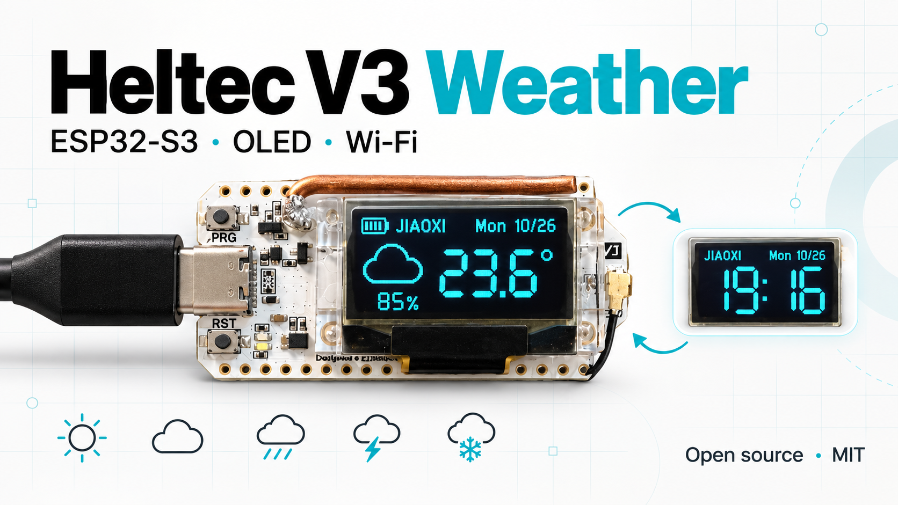
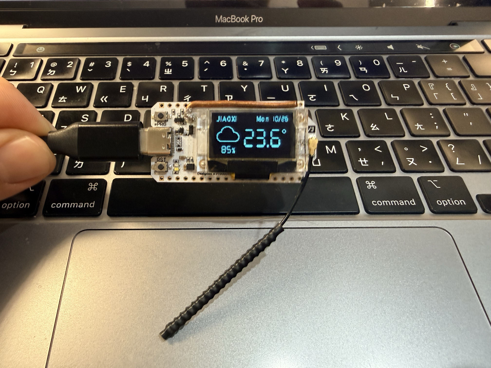
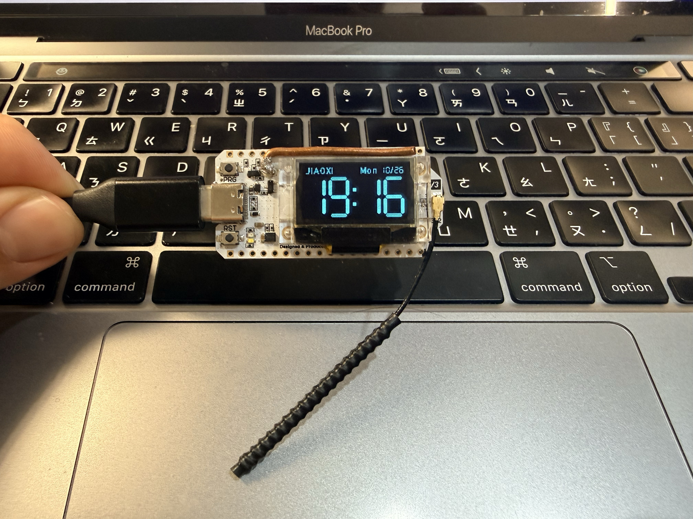
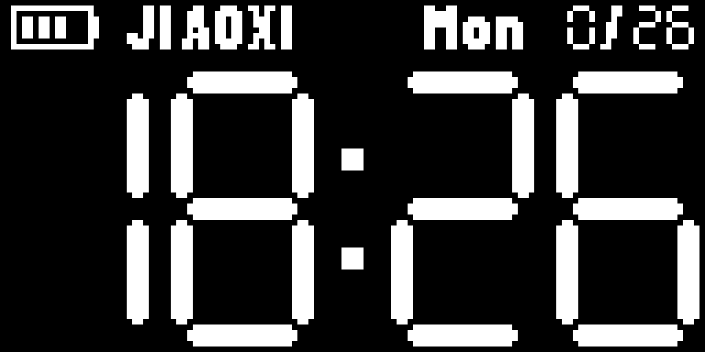
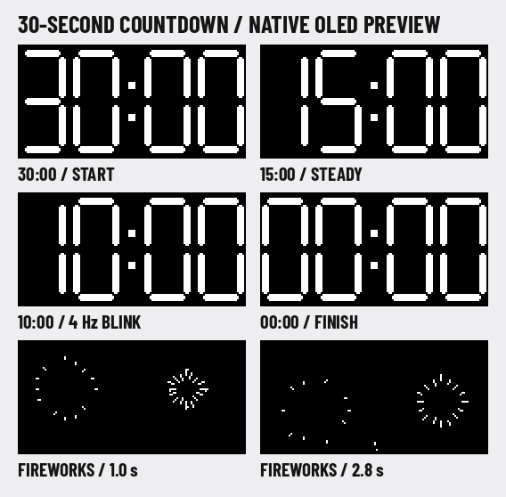
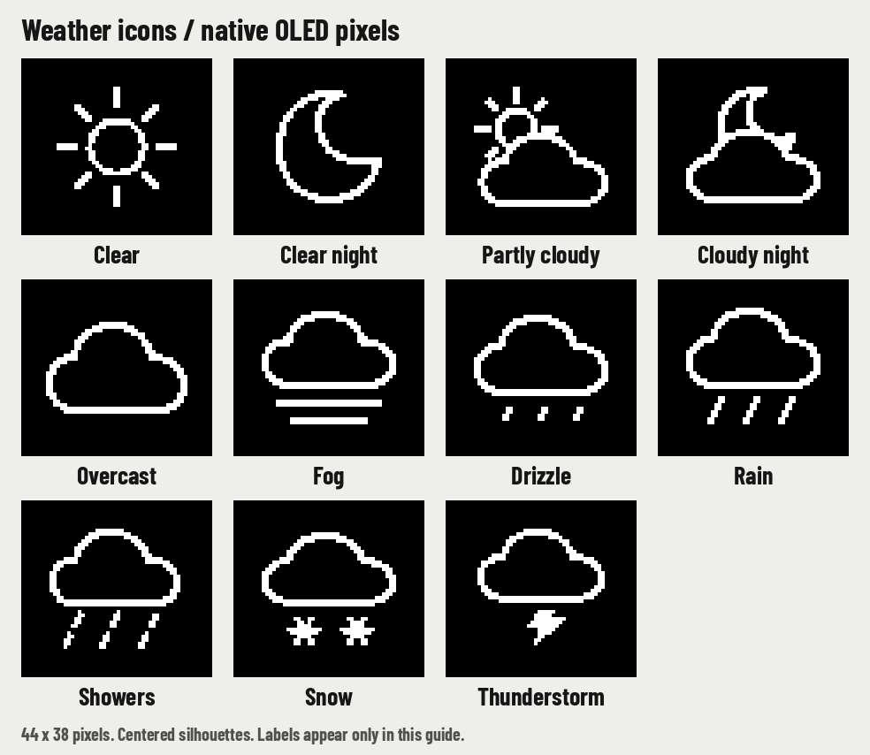

# Heltec V3 Weather



A Wi-Fi weather clock for **Heltec WiFi LoRa 32 V3**, with a 128 × 64 OLED,
seven-segment numerals, weather icons, humidity and a battery indicator.

把 Heltec V3 變成小型氣象時鐘：短按 PRG 手動切換時間與天氣頁，畫面持續停留在所選頁面。
不需要室外感測器，透過 Wi-Fi 取得網路天氣。預設示範地點為台灣礁溪，時區 UTC+8。

[MIT license](LICENSE) · [Weather icons](docs/WEATHER-ICONS.md) · [Privacy review](docs/PRIVACY.md) · [Third-party notices](THIRD_PARTY_NOTICES.md)

封面為 AI 輔助製作的專案插圖，下面兩張為實機照片。

## 實機照片 / Real device

| 天氣頁 / Weather | 時間頁 / Clock |
| --- | --- |
|  |  |

照片由專案擁有者提供，已移除 EXIF／GPS 中繼資料；拍攝的是加入電池圖示前的版本。
Weather data by [Open-Meteo](https://open-meteo.com/), [CC BY 4.0](https://creativecommons.org/licenses/by/4.0/).

## 公開版介面 / Interface



動畫依序展示兩頁；實機以按鈕切換，不會自動輪播。這是同一份韌體繪圖程式產生的示範資料，不是即時氣象或照片。公開版使用可再散布的
Barlow Condensed 字型；大數字、日期數字與濕度數字由程式繪製七段式字形。

- 頂列固定：電池圖示 → `JIAOXI` → 英文星期／日期。
- 時間頁：滿版七段式 `HH:MM`。
- 天氣頁：左側置中圖示與濕度，右側大溫度及 `°`。
- 11 種原生天氣圖示，依天氣代碼與日夜狀態切換，不在天氣頁顯示英文天氣名稱。
- 開機顯示時間頁；每分鐘更新時間，每 15 分鐘更新天氣並 NTP 校時，背景更新維持所選頁面。
- 更新失敗保留舊資料，約 5 分鐘後重試；資料過期時出現 `!`。

## PRG 與配網 / Controls

| 操作 | 功能 |
| --- | --- |
| 短按 PRG／BOOT 一下 | 放開後等待約 0.4 秒辨識連按，再切換時間／天氣頁 |
| 連按 PRG／BOOT 三下 | 啟動 30 秒倒數，每下間隔須小於 0.4 秒 |
| 長按 PRG／BOOT 約 3 秒 | 取消正在執行的倒數並開啟 Wi-Fi 配網；若正在下載，等該次下載結束後開啟 |
| RESET | 重新開機，保留已存 Wi-Fi 設定 |

首次開機會顯示裝置的配網 Wi-Fi 名稱和密碼。手機連上該 Wi-Fi 後，開啟
`http://192.168.4.1`，輸入家中 **2.4 GHz** Wi-Fi。配網頁面閒置 10 分鐘會關閉並休眠。
Wi-Fi 名稱與密碼只在裝置 NVS 中保存，原始碼沒有預填任何使用者的 Wi-Fi 資料。

## 30 秒倒數 / Countdown

三連按後，畫面僅顯示滿版七段式 `30:00 → 00:00`。格式為 **秒：百分之一秒**，
計時使用單調遞增的微秒時鐘，OLED 更新目標為 25 fps，末兩位依當下剩餘時間顯示。
NTP 校時與偶爾延遲的畫格不會延長倒數。地點、日期、電池及天氣在倒數期間隱藏。

- 剩餘 15 秒開始以約 1 Hz 閃爍，剩餘 5 秒加快為約 4 Hz。
- 結束顯示 `00:00` 約 0.2 秒，接著播放 **4 秒煙火動畫**。
- 動畫結束回到啟動前的時間或天氣頁，恢復手動切頁與省電待機。
- 倒數與煙火期間的短按不會換頁或重新計時；長按 3 秒仍可進入配網。
- 為避免三連按時畫面跳動，普通點擊會等 0.4 秒確認；連按兩下的結果是保留原頁。



[完整即時速度預覽](docs/images/countdown-demo.gif) · [4 秒煙火預覽](docs/images/fireworks-demo.gif)

預覽由韌體同一套繪圖程式產生；最後的時間頁為固定示範資料。相同倒數、按鍵與繪圖邏輯已於原字型版 v1.1.8 實機驗證：30 秒倒數、4 秒煙火、855 格／25 fps、返回原頁與單按切頁均通過。公開字型版 v1.2.2 以編譯及原生測試驗證，詳見 [驗證記錄](docs/BUILD-VALIDATION.json)。
動畫期間主控保持運作，新的網路請求與電池量測延後至動畫結束，已開始的下載可繼續完成。

## 電池與省電 / Battery and power

使用已接妥的 3.7 V 單節鋰電池。電量圖示依電壓粗估為四格，每分鐘更新；
約 3.45 V 以下顯示 `!` 提醒充電，無有效讀值顯示 `?`。
這不是精密電量百分比；充電、負載與電池型號都會影響讀值。
只有 USB、沒有電池時，無法可靠判斷電池是否存在。

韌體會辨識 V3／V3.1 與 V3.2 的電池量測控制方向。Wi-Fi 關閉後使用
light sleep，等按鍵、整分鐘或電池量測時間喚醒；OLED 持續顯示。LoRa 不參與天氣接收，開機後設為休眠。
一般活動頻率為 80 MHz，網路工作時暫用 240 MHz。OLED 對比值白天為 2，夜間 22:00～07:00 降為 0（依裝置設定時區；控制值範圍為 0～255，0 是最低對比設定）。開機及時間同步前使用 2。
尚未提供平均電流或電池續航的實測保證。

## 編譯與刷入 / Build and flash

需求：Python 3.10+、可傳資料的 USB 線，以及 Heltec WiFi LoRa 32 V3。
首次安裝建議先備份板上原有韌體；備份可能含 Wi-Fi 設定，應只保存在本機。

```sh
git clone https://github.com/MAXXTANG/Heltec-V3-Weather.git
cd Heltec-V3-Weather
python3 -m venv .venv
source .venv/bin/activate
python -m pip install -r requirements.txt
python tools/build.py
python tools/build.py -t upload
```

Windows 可用 `.venv\Scripts\activate` 啟用虛擬環境。若接了多個序列裝置，
加上 `--upload-port` 指定目標；這份韌體適用 V3，不能刷到 Wireless Paper。

建置結果位於 `.pio/build/heltec-v3/`。這個公開 repo 提供原始碼，不包含任何原機 Flash／NVS
備份或舊版韌體二進位。公開版 v1.2.2 的編譯與驗證記錄見 [BUILD-VALIDATION.json](docs/BUILD-VALIDATION.json)。

## 修改地點 / Location

編輯 [`src/weather_config.h`](src/weather_config.h)：

- `WEATHER_LOCATION`：頂列地點名稱；小螢幕建議維持短名稱，修改後檢查預覽。
- `WEATHER_LATITUDE`、`WEATHER_LONGITUDE`：查詢座標。
- `WEATHER_TIMEZONE`：POSIX 時區，例如 `CST-8` 是 UTC+8。

預設座標是公開的礁溪鎮中心示範點，不是從照片 GPS 或裝置定位取得。
時間來自 NTP；溫度、濕度是氣象模式資料，不是室內感測值。

## 圖示與測試 / Icons and tests



圖示標籤僅供文件說明；裝置使用原生 44 × 38 px 圖形。完整代碼對照見
[天氣圖示說明](docs/WEATHER-ICONS.md)。

```sh
python tools/generate_fonts.py
python tools/generate_weather_icons.py
sh tests/run.sh
```

原生測試需要 `clang++`（也可設定 `CXX=g++`），使用 ASan／UBSan，涵蓋全天時間、
天氣與溫濕度邊界、頂列及圖示對齊、電池量測方向／電壓門檻、排程邊界、三連按／長按／彈跳、
30 秒與閃爍門檻、3,001 組倒數數字排版及 100 格煙火畫面。
產生的畫面在 `docs/images/`；七段式時鐘主體與先前已驗證版本逐像素比對。

## 接腳 / Pins

| 功能 | GPIO |
| --- | --- |
| OLED SDA / SCL / RESET | 17 / 18 / 21 |
| Vext | 36，低電位開啟 |
| PRG／BOOT / LED | 0 / 35 |
| 電池 ADC / 控制 | 1 / 37 |
| SX1262 CS / SCK / MOSI / MISO | 8 / 9 / 10 / 11 |
| SX1262 RESET / BUSY | 12 / 13 |

參考 [Heltec 官方 V3 資源](https://resource.heltec.cn/download/WiFi_LoRa_32_V3/)。

## 授權與資料來源 / Licensing

原創程式、七段式繪圖、天氣圖示及本專案文件採 [MIT](LICENSE)。
字型及字母／符號點陣保留 **SIL OFL 1.1**；下載的框架與函式庫依各自授權。
詳細範圍見 [THIRD_PARTY_NOTICES.md](THIRD_PARTY_NOTICES.md)。

Weather data by [Open-Meteo](https://open-meteo.com/), [CC BY 4.0](https://creativecommons.org/licenses/by/4.0/).
資料與 API 服務條款不因本專案 MIT 授權而改變；使用 API 時請遵守
[Open-Meteo 的現行授權與使用條款](https://open-meteo.com/en/licence)。
